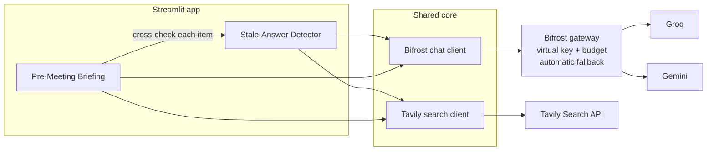

# Fresh Facts

Live-web verification for AI answers and meeting prep, built on **Tavily** and
**Bifrost by Maxim AI** for the Geek Room Global AI Hackathon 2026.

It addresses two Tavily problem statements with one shared engine:

| Tool | Problem statement | What it does |
|---|---|---|
| **Stale-Answer Detector** | 06 | Takes an AI-generated answer, finds the time-sensitive claims, re-checks each against the live web and gives every claim a 0-100 freshness score. |
| **Pre-Meeting Briefing** | 05 | Takes a company or person and a meeting time, researches the previous 30 days and produces a one-page, sourced briefing. Every item is then re-checked by the detector, so verified developments are separated from uncertain or disputed ones. |

## Why

Language models state outdated facts with full confidence: a price that changed, a
version that was superseded, a CEO who left last week. The fix is not a bigger model,
it is checking the claim against today's web and showing the evidence.

While building this, the detector flagged "Jensen Huang is the CEO of Nvidia" as
outdated. The hand-written test label said it was still true; the label was the stale
one, because he had resigned four days earlier. Undated pages (the company bio,
Wikipedia, LinkedIn) still named him CEO; only dated news showed the change. That is
the problem in one example, and it is why the pipeline searches dated news separately.

## How it works



### Stale-Answer Detector

1. **Claim identification.** A fast model extracts the time-sensitive claims (prices,
   versions, laws, who holds a role, statistics) and writes a search query for the
   *current* state of each.
2. **Live verification.** Tavily runs two searches per claim: a general search for
   relevance and a news search over the last year for dated evidence.
3. **Freshness detection.** A stronger model judges each claim using only those
   sources: `current`, `outdated`, `contradicted` or `unverifiable`. It may not call a
   claim current on the strength of an old report of a past event.
4. **Freshness scoring.** The 0-100 score is computed in plain, tested code
   ([stale_detector/scoring.py](stale_detector/scoring.py)), not by the model:
   - each verdict has a base value (current 1.0, unverifiable 0.5, outdated 0.15, contradicted 0);
   - the model's confidence pulls that value toward 50, so an unsure verdict scores near the middle;
   - a "current" claim is discounted when few sources support it or they are old
     (recency halves every 180 days).

### Pre-Meeting Briefing

1. **Meeting context.** Subject, meeting date and time, purpose, optional focus notes.
2. **Recent research.** Three Tavily news searches restricted to the 30 days before the
   meeting (never past today). Results outside the window are dropped.
3. **Concise briefing.** A model drafts a summary, up to five developments and up to
   five open questions. Every development must cite source numbers; items with no
   valid citation are discarded.
4. **Verified vs uncertain.** Each development is re-verified by the detector with a
   fresh search. Confirmed items stay verified, contradicted ones become disputed, and
   ones a second search cannot confirm are downgraded to uncertain.
5. **One page out.** Shown in the app and downloadable as Markdown.

## How each technology contributes

**Tavily** is the only source of facts. Models are instructed to use nothing but the
numbered Tavily results, and every claim and briefing item links back to them.
The project uses general search, news search with a `days` window, and news search
with explicit `start_date` / `end_date`.

**Bifrost** is the only path to a model. The app never holds a provider key.

- **One endpoint, two providers.** Groq and Gemini sit behind
  `POST /v1/chat/completions`.
- **Model routing by task.** A small fast model extracts claims; a stronger one
  verifies and drafts.
- **Automatic fallback.** Every request names a fallback on the other provider.
  The app reads Bifrost's `routing_info` and shows which provider actually answered.
  This fired for real during development when Google's newest Flash model returned 503.
- **Governance.** The app authenticates with a Bifrost virtual key capped by a
  monthly budget, defined in [bifrost/config.json](bifrost/config.json).

## Evaluation

[eval/claims.json](eval/claims.json) holds 24 hand-labelled claims (13 stale, 11 fresh).
`python -m eval.run_eval` runs them through the full pipeline.

Run of 2026-11-16 ([eval/results.md](eval/results.md)):

| Metric | Result |
|---|---|
| Verdicts given | 22 of 24 (2 abstained after provider rate limits) |
| Correct when a verdict was given | 22 of 22 |
| Stale claims caught | 13 of 13 |
| False alarms on fresh claims | 0 |

This is a small set labelled by one person, and one label was corrected after the run
(the Nvidia example above), so read it as a sanity check, not a benchmark.

## Setup

Requirements: Python 3.12+, Node.js 20+ (to run Bifrost with `npx`), and free API keys
for [Tavily](https://tavily.com), [Groq](https://console.groq.com) and
[Google AI Studio](https://aistudio.google.com).

```bash
git clone https://github.com/mgoblimar/bifrost_tavily_global_ai_hackathon.git
cd bifrost_tavily_global_ai_hackathon
python -m venv .venv
.venv/Scripts/python -m pip install -r requirements.txt    # Windows
# .venv/bin/python -m pip install -r requirements.txt      # macOS / Linux
```

Copy `.env.example` to `.env` and fill in:

| Variable | Value |
|---|---|
| `GROQ_API_KEY`, `GEMINI_API_KEY` | Your provider keys (read by Bifrost only) |
| `TAVILY_API_KEY` | Your Tavily key |
| `BIFROST_VIRTUAL_KEY` | Any secret you choose, starting with `sk-bf-` |
| `BIFROST_SETUP_TOKEN` | Any secret you choose; used once to create the Bifrost dashboard admin |

Each variable must appear only once in the file.

Start the gateway (terminal 1). On Windows:

```bash
powershell -ExecutionPolicy Bypass -File scripts/start_bifrost.ps1
```

On macOS / Linux, export the variables from `.env` and run:

```bash
npx -y @maximhq/bifrost -app-dir ./bifrost -port 8090
```

Start the app (terminal 2) and open http://localhost:8501:

```bash
.venv/Scripts/python -m streamlit run app.py
```

The gateway listens on port 8090 and its dashboard is at http://localhost:8090.

### Tests

```bash
.venv/Scripts/python -m pytest -q
```

49 unit tests cover scoring, both pipelines, the gateway client and the Markdown
renderer, with the gateway and the web faked. They need no keys.

## Project layout

```
app.py                     Streamlit home page
pages/                     The two tool pages
core/                      Shared: settings, Bifrost chat client, Tavily search client
stale_detector/            Claim extraction, verification, freshness scoring
briefing/                  Research window, drafting, cross-check, Markdown rendering
eval/                      Labelled claims, eval runner, latest results
bifrost/config.json        Providers, virtual key and budget for the gateway
scripts/start_bifrost.ps1  Loads .env and starts Bifrost
tests/                     Unit tests
```

## Technologies

Python 3.12, Streamlit, Tavily Search API (`tavily-python`), Bifrost gateway v2.5
(`@maximhq/bifrost`), Groq and Google Gemini models, pytest.

## Limitations

- Free-tier provider limits are easy to hit. When both providers are rate-limited at
  once the app retries twice, then marks the item as not checked instead of guessing.
- Verdicts are only as good as what Tavily returns. General search results carry no
  publish date, which is why dated news is searched separately.
- The detector checks at most 6 claims per answer and the briefing at most 5
  developments, to keep runs fast and cheap.
- The briefing is not disambiguated automatically: for a common name, add a focus
  note saying which company or person you mean.
- Model names are set in `.env`. Providers retire models often; if a call fails with
  "model not allowed", pick a current name from the Bifrost dashboard.
