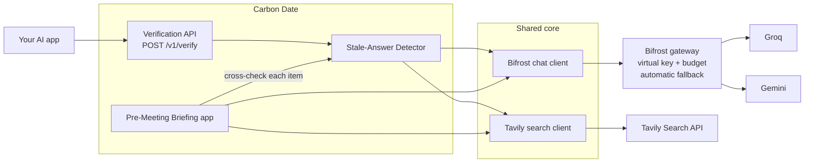

# Carbon Date

A freshness check for AI applications, built on **Tavily** and **Bifrost by Maxim AI**
for the Geek Room Global AI Hackathon 2026, by Team Jenx.

Send it any AI-generated answer. It finds the time-sensitive claims, re-checks each one
against the live web, and returns a verdict, the current value, a 0-100 freshness score
and the sources for every claim.

| Part | Problem statement | What it is |
|---|---|---|
| **Verification layer** | 06, Stale-Answer Detector for AI Applications | An HTTP API (`POST /v1/verify`) that any AI app can call before showing a model's answer, plus a page for trying it by hand. |
| **Pre-Meeting Briefing** | 05, Pre-Meeting Briefing Agent | An AI application built on that layer. It researches a company or person over the last 30 days, drafts a one-page briefing, then uses the layer to check its own draft and the user's talking points. |

## Demo video

[demo/carbon-date-demo.mp4](demo/carbon-date-demo.mp4) is a narrated walkthrough, a little
over two minutes long, of real runs in three parts: the API (the example chat app in a
terminal, then a call in the API docs page), the Stale-Answer Detector page and the
Pre-Meeting Briefing page. Waiting time is trimmed and marked as such on screen.

The scripts in `demo/` produce the silent screen recording it is built from (they need
`pip install playwright imageio-ffmpeg`); the narration and music were added afterwards.

## Who it is for

**Developers who ship AI features.** A model's knowledge stops at its training date, but
its answers carry no date. If your assistant, support bot or internal tool states a price,
a version, a rule or who holds a role, you have no way to know whether that is still true.
Carbon Date is one HTTP call between your model and your user: it tells you how old
an answer really is.

It matters most for apps that answer **without live web search**: custom assistants,
support bots, tools that answer from stored documents, and smaller or older models.
Chat products with search switched on usually get recent facts right on their own.

The briefing agent shows the pattern on a real task: someone preparing for a sales,
partnership or investor meeting, who needs recent facts and cannot afford a stale one.

## Add it to your AI app

Your app already has step 1. Carbon Date is step 2.

```python
answer = my_model(question)                       # 1. your existing model call

report = requests.post(                           # 2. check it before showing it
    "http://localhost:8600/v1/verify",
    json={"answer": answer},
    timeout=180,
).json()

for claim in report["claims"]:                    # 3. flag or correct what expired
    if claim["is_stale"]:
        print("Outdated:", claim["claim"], "->", claim["current_value"])
```

Request fields: `answer` (required, up to 8,000 characters), `trusted_domains` (optional
list of official sites to search first) and `context` (optional note on what the answer
is about).

Response, shortened:

```json
{
  "overall_freshness": 15,
  "claims_checked": 1,
  "stale_claims": 1,
  "claims": [
    {
      "claim": "The latest stable Python release is 3.12",
      "verdict": "outdated",
      "is_stale": true,
      "freshness_score": 15,
      "current_value": "Python 3.15",
      "evidence_basis": "Dated news",
      "sources": [
        {"title": "...", "url": "...", "published": "2026-10-07",
         "official": false, "used_for_verdict": true}
      ]
    }
  ],
  "gateway": [{"requested_model": "...", "served_by": "...", "is_fallback": false}],
  "warnings": []
}
```

[examples/guarded_chat.py](examples/guarded_chat.py) is a complete small app that does
this. A real run on 16 November 2026:

```text
$ python -m examples.guarded_chat "Who is the CEO of Nvidia, and what is the latest stable version of Python?"

ASSISTANT:
The current CEO of Nvidia is Jensen Huang. The most recent stable release of the
Python programming language is Python 3.12.4, which was finalized in mid-2024...

FRESHNESS CHECK: 3 of 4 claims are out of date.
  - Said: The current CEO of Nvidia is Jensen Huang
    Now:  Colette Kress (interim CEO)
    Source: https://nvidianews.nvidia.com/news/nvidia-announces-ceo-transition
  - Said: The most recent stable release of the Python programming language is Python 3.12.4
    Now:  Python 3.15.x (e.g., Python 3.15.2)
    Source: https://en.wikipedia.org/wiki/Python_(programming_language)
  ...
```

The model was given no instruction about hedging; it stated both facts without a caveat.

Two options sharpen the check:

- **Official sources first.** Pass `trusted_domains`, such as a regulator or the
  company's own site. They are searched first, and each verdict is labelled as resting
  on an official source, dated news or undated web pages. The label says where a verdict
  came from; it does not settle regulatory questions.
- **Talking points.** In the briefing page, paste what you or a chatbot drafted for the
  meeting. Lines that are no longer true are marked "do not say this".

## Why

Language models state outdated facts with full confidence: a price that changed, a
version that was superseded, a CEO who left last week. The fix is not a bigger model,
it is checking the claim against today's web and showing the evidence.

While building this, the detector flagged "Jensen Huang is the CEO of Nvidia" as
outdated. The hand-written test label said it was still true; the label was the stale
one, because he had resigned four days earlier. Undated pages (the company bio,
Wikipedia, LinkedIn) still named him CEO; only dated news showed the change. That is
the problem in one example, and it is why the pipeline searches dated news separately.

## How it works



### Stale-Answer Detector

1. **Claim identification.** A fast model extracts the time-sensitive claims (prices,
   versions, laws, who holds a role, statistics) and writes a search query for the
   *current* state of each.
2. **Live verification.** Tavily runs two searches per claim: a general search for
   relevance and a news search over the last year for dated evidence. If you named
   trusted sites, a third search covers only those and its results are listed first.
3. **Freshness detection.** A stronger model judges each claim using only those
   sources: `current`, `outdated`, `contradicted` or `unverifiable`. It may not call a
   claim current on the strength of an old report of a past event.
4. **Freshness scoring.** The 0-100 score is computed in plain, tested code
   ([stale_detector/scoring.py](stale_detector/scoring.py)), not by the model:
   - each verdict has a base value (current 1.0, unverifiable 0.5, outdated 0.15, contradicted 0);
   - the model's confidence pulls that value toward 50, so an unsure verdict scores near the middle;
   - a "current" claim is discounted when few sources support it or they are old
     (recency halves every 180 days).

### Pre-Meeting Briefing

1. **Meeting context.** Subject, meeting date and time, purpose, optional focus notes.
2. **Recent research.** Three Tavily news searches restricted to the 30 days before the
   meeting (never past today). Results outside the window are dropped.
3. **Concise briefing.** A model drafts a summary, up to five developments and up to
   five open questions. Every development must cite source numbers; items with no
   valid citation are discarded.
4. **Verified vs uncertain.** Each development is re-verified by the detector with a
   fresh search. Confirmed items stay verified, contradicted ones become disputed, and
   ones a second search cannot confirm are downgraded to uncertain.
5. **Talking points.** If you pasted talking points, the detector checks them with
   the account as context and marks the ones you should not say.
6. **One page out.** Shown in the app and downloadable as Markdown.

## How each technology contributes

**Tavily** is the only source of facts. Models are instructed to use nothing but the
numbered Tavily results, and every claim and briefing item links back to them.
The project uses general search, news search with a `days` window, news search
with explicit `start_date` / `end_date`, and `include_domains` for official sites.

**Bifrost** is the only path to a model. The app never holds a provider key.

- **One endpoint, two providers.** Groq and Gemini sit behind
  `POST /v1/chat/completions`.
- **Model routing by task.** A small fast model extracts claims; a stronger one
  verifies and drafts.
- **Automatic fallback.** Every request names a fallback on the other provider.
  The app reads Bifrost's `routing_info` and shows which provider actually answered.
  This fired for real during development when Google's newest Flash model returned 503.
- **Governance.** The app authenticates with a Bifrost virtual key capped by a
  monthly budget, defined in [bifrost/config.json](bifrost/config.json).

## Evaluation

[eval/claims.json](eval/claims.json) holds 24 hand-labelled claims (13 stale, 11 fresh).
`python -m eval.run_eval` runs them through the full pipeline.

Run of 2026-11-16 ([eval/results.md](eval/results.md)):

| Metric | Result |
|---|---|
| Verdicts given | 22 of 24 (2 abstained after provider rate limits) |
| Correct when a verdict was given | 22 of 22 |
| Stale claims caught | 13 of 13 |
| False alarms on fresh claims | 0 |

This is a small set labelled by one person, and one label was corrected after the run
(the Nvidia example above), so read it as a sanity check, not a benchmark.

## Run it yourself

Carbon Date runs on your own machine. Setup takes about ten minutes and uses only
free-tier accounts. Three programs run side by side, each in its own terminal:

| Program | Port | What it does |
|---|---|---|
| Bifrost gateway | 8090 | Holds the model provider keys and routes every model call |
| Carbon Date API | 8600 | `POST /v1/verify`, the check other apps call |
| Web pages | 8501 | The Stale-Answer Detector and Pre-Meeting Briefing pages |

The steps below were run on Windows 11. The macOS and Linux commands are the standard
equivalents and have not been tested by us.

### 1. What you need

- **Python 3.12 or newer** and **Node.js 20 or newer** (Node runs the Bifrost gateway through `npx`).
- **Three free API keys:**

| Key | Where to get it | Used for |
|---|---|---|
| Tavily | https://tavily.com | Live web search |
| Groq | https://console.groq.com | The fast model that extracts claims |
| Gemini | https://aistudio.google.com | The stronger model that verifies and drafts |

### 2. Download and install

```bash
git clone https://github.com/mgoblimar/bifrost_tavily_global_ai_hackathon.git
cd bifrost_tavily_global_ai_hackathon
python -m venv .venv
```

Then install the dependencies. On Windows:

```bash
.venv/Scripts/python -m pip install -r requirements.txt
```

On macOS or Linux:

```bash
.venv/bin/python -m pip install -r requirements.txt
```

In the rest of this guide, replace `.venv/Scripts/python` with `.venv/bin/python` on
macOS or Linux.

### 3. Add your keys

Copy `.env.example` to a new file named `.env` in the same folder and fill in these five
values. `.env` is git-ignored, so your keys stay on your machine.

| Variable | What to put |
|---|---|
| `GROQ_API_KEY` | Your Groq key |
| `GEMINI_API_KEY` | Your Gemini key |
| `TAVILY_API_KEY` | Your Tavily key |
| `BIFROST_VIRTUAL_KEY` | A secret you make up, starting with `sk-bf-`, for example `sk-bf-` followed by 32 random characters. The app uses it to identify itself to the gateway. |
| `BIFROST_SETUP_TOKEN` | Another secret you make up. Used once, to create the gateway's dashboard login. |

Leave the other lines (`BIFROST_URL` and the four model names) as they are.
Each variable must appear **only once** in the file; a duplicate silently overrides the first.

### 4. Start the Bifrost gateway (terminal 1)

On Windows:

```bash
powershell -ExecutionPolicy Bypass -File scripts/start_bifrost.ps1
```

On macOS or Linux:

```bash
set -a && . ./.env && set +a && npx -y @maximhq/bifrost -app-dir ./bifrost -port 8090
```

The first start downloads the gateway and takes about a minute. It is ready when this
returns a healthy status:

```bash
curl http://localhost:8090/health
```

### 5. Start the Carbon Date API (terminal 2)

```bash
.venv/Scripts/python -m uvicorn api:app --port 8600
```

Check it:

```bash
curl http://localhost:8600/health
```

You should see `{"status":"ok"}`. Interactive API docs are at http://localhost:8600/docs.

### 6. Start the web pages (terminal 3)

```bash
.venv/Scripts/python -m streamlit run app.py
```

Open http://localhost:8501.

### 7. Try the three ways to use it

**The API, from the example chat app.** In a fourth terminal:

```bash
.venv/Scripts/python -m examples.guarded_chat "Who is the CEO of Nvidia, and what is the latest stable version of Python?"
```

It prints the model's answer, then a freshness check listing any claims that are out of
date, with the current value and a source for each.

**The API, directly.** Open http://localhost:8600/docs, expand `POST /v1/verify`, choose
"Try it out", and send:

```json
{"answer": "The latest stable Python release is 3.12, and Node.js 18 is the current LTS version."}
```

**The Stale-Answer Detector page.** At http://localhost:8501, open "Stale-Answer
Detector" and choose "Check freshness". The box is pre-filled with a sample answer.

**The Pre-Meeting Briefing page.** Open "Pre-Meeting Briefing", enter a company such as
`Nvidia`, optionally paste talking points and a trusted site such as `nvidia.com`, and
choose "Build briefing".

A detector run takes 20 to 60 seconds and a briefing one to two minutes, because each
does several live searches and model calls.

### What a run costs

Everything fits in the free tiers, but they are finite:

- A detector run uses about 18 Tavily credits; a briefing uses 30 to 60.
- Gemini's free tier has a daily request limit. When it runs out, calls fall back to Groq
  and runs get slower until the limit resets.
- The gateway caps paid spend for the app's virtual key at 5 US dollars a month
  (set in [bifrost/config.json](bifrost/config.json)).

### Troubleshooting

These are the problems we hit ourselves.

| What you see | Cause | Fix |
|---|---|---|
| The gateway exits with "failed to create listener" | Port 8090 is already in use | Change `-port` in the start command and `BIFROST_URL` in `.env` to a free port |
| The start script says a variable "is empty in .env" | A key is missing, or the variable appears twice with an empty copy | Fill it in, and make sure each variable appears once |
| "virtual key is required" (HTTP 401) | `BIFROST_VIRTUAL_KEY` was changed after the gateway started | Restart the gateway |
| "Model ... is not allowed for virtual key" (HTTP 403) | The provider has retired that model | List current models (command below) and update the four model names in `.env` |
| "Both model providers are rate-limited" | Free-tier limits on Groq and Gemini were hit together | Wait a minute and try again |
| "Cannot reach the Bifrost gateway" | The gateway is not running | Start it (step 4) |
| Items marked "could not cross-check" in a briefing | A rate limit during the cross-check | The briefing keeps the drafted status; run it again later |
| The gateway dashboard asks for a setup token | First visit to http://localhost:8090 | Enter your `BIFROST_SETUP_TOKEN`, then create an admin account |

To list the models your gateway can reach, with your virtual key in place of `sk-bf-...`:

```bash
curl -H "x-bf-vk: sk-bf-..." http://localhost:8090/v1/models
```

To require a key on the Carbon Date API, set `CARBON_DATE_API_KEY` before starting it;
callers then send it in the `X-API-Key` header. Without it the API is open, so keep it
on localhost.

### Stopping

Press Ctrl+C in each terminal. Nothing keeps running in the background.

### Tests

```bash
.venv/Scripts/python -m pytest -q
```

70 unit tests cover scoring, both pipelines, the API, trusted-site handling, the
gateway client and the Markdown renderer, with the gateway and the web faked. They need
no keys and no running servers.

## Project layout

```
api.py                     Verification API (FastAPI)
examples/guarded_chat.py   Example AI app that calls the API
app.py                     Streamlit home page
pages/                     The two tool pages
core/                      Shared: settings, Bifrost chat client, Tavily search client, trusted sites
stale_detector/            Claim extraction, verification, freshness scoring, shared UI pieces
briefing/                  Research window, drafting, cross-check, talking points, Markdown rendering
eval/                      Labelled claims, eval runner, latest results
bifrost/config.json        Providers, virtual key and budget for the gateway
scripts/start_bifrost.ps1  Loads .env and starts Bifrost
demo/                      Demo video and the scripts that record it
tests/                     Unit tests
```

## Technologies

Python 3.12, FastAPI, Streamlit, Tavily Search API (`tavily-python`), Bifrost gateway v2.5
(`@maximhq/bifrost`), Groq and Google Gemini models, pytest.

## Limitations

- Free-tier provider limits are easy to hit. When both providers are rate-limited at
  once the app retries twice, then marks the item as not checked instead of guessing.
- Verdicts are only as good as what Tavily returns. General search results carry no
  publish date, which is why dated news is searched separately.
- An undated official page can lag behind events. The verifier is told that several
  recent dated reports of a change outrank it, but this relies on the model's judgement.
- A check takes 20 to 75 seconds, so it suits answers people will act on, not every
  chat message. It runs after the model call, not in the stream.
- The API has an optional shared key and no rate limiting of its own; put it behind
  your own gateway before exposing it beyond localhost.
- The detector checks at most 6 claims per answer and the briefing at most 5
  developments, to keep runs fast and cheap.
- The briefing is not disambiguated automatically: for a common name, add a focus
  note saying which company or person you mean.
- Model names are set in `.env`. Providers retire models often; if a call fails with
  "model not allowed", pick a current name from the Bifrost dashboard.
