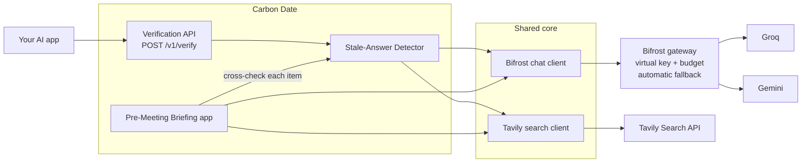

# Carbon Date

A freshness check for AI applications, built on **Tavily** and **Bifrost by Maxim AI**
for the Geek Room Global AI Hackathon 2026, by Team Jenx.

Send it any AI-generated answer. It finds the time-sensitive claims, re-checks each one
against the live web, and returns a verdict, the current value, a 0-100 freshness score
and the sources for every claim.

| Part | Problem statement | What it is |
|---|---|---|
| **Verification layer** | 06, Stale-Answer Detector for AI Applications | An HTTP API (`POST /v1/verify`) that any AI app can call before showing a model's answer, plus a page for trying it by hand. |
| **Pre-Meeting Briefing** | 05, Pre-Meeting Briefing Agent | An AI application built on that layer. It researches a company or person over the last 30 days, drafts a one-page briefing, then uses the layer to check its own draft and the user's talking points. |

## Demo video

[demo/carbon-date-demo.mp4](demo/carbon-date-demo.mp4) is a two-minute silent, captioned
recording of real runs in three parts, each introduced by a title card: the API
(the example chat app in a terminal, then a call in the API docs page), the detector
page and the briefing page. Waiting time is trimmed and marked as such.
The scripts in `demo/` re-record it (they need `pip install playwright imageio-ffmpeg`).

## Who it is for

**Developers who ship AI features.** A model's knowledge stops at its training date, but
its answers carry no date. If your assistant, support bot or internal tool states a price,
a version, a rule or who holds a role, you have no way to know whether that is still true.
Carbon Date is one HTTP call between your model and your user: it tells you how old
an answer really is.

It matters most for apps that answer **without live web search**: custom assistants,
support bots, tools that answer from stored documents, and smaller or older models.
Chat products with search switched on usually get recent facts right on their own.

The briefing agent shows the pattern on a real task: someone preparing for a sales,
partnership or investor meeting, who needs recent facts and cannot afford a stale one.

## Add it to your AI app

Your app already has step 1. Carbon Date is step 2.

```python
answer = my_model(question)                       # 1. your existing model call

report = requests.post(                           # 2. check it before showing it
    "http://localhost:8600/v1/verify",
    json={"answer": answer},
    timeout=180,
).json()

for claim in report["claims"]:                    # 3. flag or correct what expired
    if claim["is_stale"]:
        print("Outdated:", claim["claim"], "->", claim["current_value"])
```

Request fields: `answer` (required, up to 8,000 characters), `trusted_domains` (optional
list of official sites to search first) and `context` (optional note on what the answer
is about).

Response, shortened:

```json
{
  "overall_freshness": 15,
  "claims_checked": 1,
  "stale_claims": 1,
  "claims": [
    {
      "claim": "The latest stable Python release is 3.12",
      "verdict": "outdated",
      "is_stale": true,
      "freshness_score": 15,
      "current_value": "Python 3.15",
      "evidence_basis": "Dated news",
      "sources": [
        {"title": "...", "url": "...", "published": "2026-10-07",
         "official": false, "used_for_verdict": true}
      ]
    }
  ],
  "gateway": [{"requested_model": "...", "served_by": "...", "is_fallback": false}],
  "warnings": []
}
```

[examples/guarded_chat.py](examples/guarded_chat.py) is a complete small app that does
this. A real run on 16 November 2026:

```text
$ python -m examples.guarded_chat "Who is the CEO of Nvidia, and what is the latest stable version of Python?"

ASSISTANT:
The current CEO of Nvidia is Jensen Huang. The most recent stable release of the
Python programming language is Python 3.12.4, which was finalized in mid-2024...

FRESHNESS CHECK: 3 of 4 claims are out of date.
  - Said: The current CEO of Nvidia is Jensen Huang
    Now:  Colette Kress (interim CEO)
    Source: https://nvidianews.nvidia.com/news/nvidia-announces-ceo-transition
  - Said: The most recent stable release of the Python programming language is Python 3.12.4
    Now:  Python 3.15.x (e.g., Python 3.15.2)
    Source: https://en.wikipedia.org/wiki/Python_(programming_language)
  ...
```

The model was given no instruction about hedging; it stated both facts without a caveat.

Two options sharpen the check:

- **Official sources first.** Pass `trusted_domains`, such as a regulator or the
  company's own site. They are searched first, and each verdict is labelled as resting
  on an official source, dated news or undated web pages. The label says where a verdict
  came from; it does not settle regulatory questions.
- **Talking points.** In the briefing page, paste what you or a chatbot drafted for the
  meeting. Lines that are no longer true are marked "do not say this".

## Why

Language models state outdated facts with full confidence: a price that changed, a
version that was superseded, a CEO who left last week. The fix is not a bigger model,
it is checking the claim against today's web and showing the evidence.

While building this, the detector flagged "Jensen Huang is the CEO of Nvidia" as
outdated. The hand-written test label said it was still true; the label was the stale
one, because he had resigned four days earlier. Undated pages (the company bio,
Wikipedia, LinkedIn) still named him CEO; only dated news showed the change. That is
the problem in one example, and it is why the pipeline searches dated news separately.

## How it works



### Stale-Answer Detector

1. **Claim identification.** A fast model extracts the time-sensitive claims (prices,
   versions, laws, who holds a role, statistics) and writes a search query for the
   *current* state of each.
2. **Live verification.** Tavily runs two searches per claim: a general search for
   relevance and a news search over the last year for dated evidence. If you named
   trusted sites, a third search covers only those and its results are listed first.
3. **Freshness detection.** A stronger model judges each claim using only those
   sources: `current`, `outdated`, `contradicted` or `unverifiable`. It may not call a
   claim current on the strength of an old report of a past event.
4. **Freshness scoring.** The 0-100 score is computed in plain, tested code
   ([stale_detector/scoring.py](stale_detector/scoring.py)), not by the model:
   - each verdict has a base value (current 1.0, unverifiable 0.5, outdated 0.15, contradicted 0);
   - the model's confidence pulls that value toward 50, so an unsure verdict scores near the middle;
   - a "current" claim is discounted when few sources support it or they are old
     (recency halves every 180 days).

### Pre-Meeting Briefing

1. **Meeting context.** Subject, meeting date and time, purpose, optional focus notes.
2. **Recent research.** Three Tavily news searches restricted to the 30 days before the
   meeting (never past today). Results outside the window are dropped.
3. **Concise briefing.** A model drafts a summary, up to five developments and up to
   five open questions. Every development must cite source numbers; items with no
   valid citation are discarded.
4. **Verified vs uncertain.** Each development is re-verified by the detector with a
   fresh search. Confirmed items stay verified, contradicted ones become disputed, and
   ones a second search cannot confirm are downgraded to uncertain.
5. **Talking points.** If you pasted talking points, the detector checks them with
   the account as context and marks the ones you should not say.
6. **One page out.** Shown in the app and downloadable as Markdown.

## How each technology contributes

**Tavily** is the only source of facts. Models are instructed to use nothing but the
numbered Tavily results, and every claim and briefing item links back to them.
The project uses general search, news search with a `days` window, news search
with explicit `start_date` / `end_date`, and `include_domains` for official sites.

**Bifrost** is the only path to a model. The app never holds a provider key.

- **One endpoint, two providers.** Groq and Gemini sit behind
  `POST /v1/chat/completions`.
- **Model routing by task.** A small fast model extracts claims; a stronger one
  verifies and drafts.
- **Automatic fallback.** Every request names a fallback on the other provider.
  The app reads Bifrost's `routing_info` and shows which provider actually answered.
  This fired for real during development when Google's newest Flash model returned 503.
- **Governance.** The app authenticates with a Bifrost virtual key capped by a
  monthly budget, defined in [bifrost/config.json](bifrost/config.json).

## Evaluation

[eval/claims.json](eval/claims.json) holds 24 hand-labelled claims (13 stale, 11 fresh).
`python -m eval.run_eval` runs them through the full pipeline.

Run of 2026-11-16 ([eval/results.md](eval/results.md)):

| Metric | Result |
|---|---|
| Verdicts given | 22 of 24 (2 abstained after provider rate limits) |
| Correct when a verdict was given | 22 of 22 |
| Stale claims caught | 13 of 13 |
| False alarms on fresh claims | 0 |

This is a small set labelled by one person, and one label was corrected after the run
(the Nvidia example above), so read it as a sanity check, not a benchmark.

## Setup

Requirements: Python 3.12+, Node.js 20+ (to run Bifrost with `npx`), and free API keys
for [Tavily](https://tavily.com), [Groq](https://console.groq.com) and
[Google AI Studio](https://aistudio.google.com).

```bash
git clone https://github.com/mgoblimar/bifrost_tavily_global_ai_hackathon.git
cd bifrost_tavily_global_ai_hackathon
python -m venv .venv
.venv/Scripts/python -m pip install -r requirements.txt    # Windows
# .venv/bin/python -m pip install -r requirements.txt      # macOS / Linux
```

Copy `.env.example` to `.env` and fill in:

| Variable | Value |
|---|---|
| `GROQ_API_KEY`, `GEMINI_API_KEY` | Your provider keys (read by Bifrost only) |
| `TAVILY_API_KEY` | Your Tavily key |
| `BIFROST_VIRTUAL_KEY` | Any secret you choose, starting with `sk-bf-` |
| `BIFROST_SETUP_TOKEN` | Any secret you choose; used once to create the Bifrost dashboard admin |

Each variable must appear only once in the file.

Start the gateway (terminal 1). On Windows:

```bash
powershell -ExecutionPolicy Bypass -File scripts/start_bifrost.ps1
```

On macOS / Linux, export the variables from `.env` and run:

```bash
npx -y @maximhq/bifrost -app-dir ./bifrost -port 8090
```

Start the verification API (terminal 2). Interactive docs are at http://localhost:8600/docs:

```bash
.venv/Scripts/python -m uvicorn api:app --port 8600
```

Start the pages (terminal 3) and open http://localhost:8501:

```bash
.venv/Scripts/python -m streamlit run app.py
```

To require a key on the API, set `CARBON_DATE_API_KEY` before starting it; callers then
send it in the `X-API-Key` header. Without it the API is open, so keep it on localhost.

The gateway listens on port 8090 and its dashboard is at http://localhost:8090.

### Tests

```bash
.venv/Scripts/python -m pytest -q
```

70 unit tests cover scoring, both pipelines, the API, trusted-site handling, the
gateway client and the Markdown renderer, with the gateway and the web faked. They need no keys.

## Project layout

```
api.py                     Verification API (FastAPI)
examples/guarded_chat.py   Example AI app that calls the API
app.py                     Streamlit home page
pages/                     The two tool pages
core/                      Shared: settings, Bifrost chat client, Tavily search client, trusted sites
stale_detector/            Claim extraction, verification, freshness scoring, shared UI pieces
briefing/                  Research window, drafting, cross-check, talking points, Markdown rendering
eval/                      Labelled claims, eval runner, latest results
bifrost/config.json        Providers, virtual key and budget for the gateway
scripts/start_bifrost.ps1  Loads .env and starts Bifrost
tests/                     Unit tests
```

## Technologies

Python 3.12, FastAPI, Streamlit, Tavily Search API (`tavily-python`), Bifrost gateway v2.5
(`@maximhq/bifrost`), Groq and Google Gemini models, pytest.

## Limitations

- Free-tier provider limits are easy to hit. When both providers are rate-limited at
  once the app retries twice, then marks the item as not checked instead of guessing.
- Verdicts are only as good as what Tavily returns. General search results carry no
  publish date, which is why dated news is searched separately.
- An undated official page can lag behind events. The verifier is told that several
  recent dated reports of a change outrank it, but this relies on the model's judgement.
- A check takes 20 to 75 seconds, so it suits answers people will act on, not every
  chat message. It runs after the model call, not in the stream.
- The API has an optional shared key and no rate limiting of its own; put it behind
  your own gateway before exposing it beyond localhost.
- The detector checks at most 6 claims per answer and the briefing at most 5
  developments, to keep runs fast and cheap.
- The briefing is not disambiguated automatically: for a common name, add a focus
  note saying which company or person you mean.
- Model names are set in `.env`. Providers retire models often; if a call fails with
  "model not allowed", pick a current name from the Bifrost dashboard.
