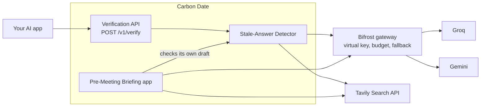

# Carbon Date

**A freshness check for AI applications.** Send it an AI-generated answer and it tells you
which claims are out of date, what is true now, and where it found out.

Built on **Tavily** and **Bifrost by Maxim AI** for the Geek Room Global AI Hackathon 2026, by Team Jenx.

▶ **[Watch the 2-minute demo](demo/carbon-date-demo.mp4)**

## What it does

A model's knowledge stops at its training date, but its answers carry no date. Here is a
real run of the example chat app on 16 November 2026:

```text
ASSISTANT:
The current CEO of Nvidia is Jensen Huang. The most recent stable release of
Python is 3.12.4...

FRESHNESS CHECK: 3 of 4 claims are out of date.
  - Said: The current CEO of Nvidia is Jensen Huang
    Now:  Colette Kress (interim CEO)
    Source: https://nvidianews.nvidia.com/news/nvidia-announces-ceo-transition
  - Said: The most recent stable release of Python is 3.12.4
    Now:  Python 3.15.x (e.g., Python 3.15.2)
    Source: https://en.wikipedia.org/wiki/Python_(programming_language)
```

The model answered from memory with no caveat. Carbon Date checked each claim against
the live web and corrected it.

## Three ways to use it

| | What it is | Who it is for | Hackathon problem statement |
|---|---|---|---|
| **1. The API** | `POST /v1/verify`: answer in, per-claim verdicts out | Developers adding the check to their own AI app | 06, Stale-Answer Detector for AI Applications |
| **2. The detector page** | The same check as a web page: paste text, read the result | Anyone checking an answer by hand | 06 |
| **3. The briefing page** | An AI app built on the check: a one-page briefing on a company or person | Someone preparing for a meeting | 05, Pre-Meeting Briefing Agent |

It matters most for apps that answer **without live web search**: custom assistants,
support bots, tools that answer from stored documents. Chat products with search switched
on usually get recent facts right on their own.

## Quick start

You need **Python 3.12+**, **Node.js 20+**, and free API keys from
[Tavily](https://tavily.com), [Groq](https://console.groq.com) and
[Google AI Studio](https://aistudio.google.com). Setup takes about ten minutes.

**1. Install**

```bash
git clone https://github.com/mgoblimar/bifrost_tavily_global_ai_hackathon.git
cd bifrost_tavily_global_ai_hackathon
python -m venv .venv
.venv/Scripts/python -m pip install -r requirements.txt
```

**2. Add your keys.** Copy `.env.example` to `.env` and fill in five values:

| Variable | What to put |
|---|---|
| `GROQ_API_KEY`, `GEMINI_API_KEY`, `TAVILY_API_KEY` | Your three keys |
| `BIFROST_VIRTUAL_KEY` | A secret you make up, starting with `sk-bf-` |
| `BIFROST_SETUP_TOKEN` | Another secret you make up |

**3. Start three programs**, each in its own terminal:

```bash
powershell -ExecutionPolicy Bypass -File scripts/start_bifrost.ps1
```

```bash
.venv/Scripts/python -m uvicorn api:app --port 8600
```

```bash
.venv/Scripts/python -m streamlit run app.py
```

**4. Try it**

| To try | Do this |
|---|---|
| The API, from a chat app | `.venv/Scripts/python -m examples.guarded_chat "Who is the CEO of Nvidia?"` |
| The API, directly | Open http://localhost:8600/docs and run `POST /v1/verify` |
| The detector page | Open http://localhost:8501, choose **Stale-Answer Detector**, then **Check freshness** |
| The briefing page | Open http://localhost:8501, choose **Pre-Meeting Briefing**, enter `Nvidia`, then **Build briefing** |

A check takes 20 to 60 seconds and a briefing one to two minutes.

<details>
<summary><b>macOS or Linux</b></summary>

These are the standard equivalents; we only tested on Windows 11.

- Use `.venv/bin/python` wherever this guide says `.venv/Scripts/python`.
- Start the gateway with:

```bash
set -a && . ./.env && set +a && npx -y @maximhq/bifrost -app-dir ./bifrost -port 8090
```

</details>

<details>
<summary><b>Check that each program is running</b></summary>

| Program | Port | Check | Expected |
|---|---|---|---|
| Bifrost gateway | 8090 | `curl http://localhost:8090/health` | A healthy status. The first start downloads the gateway and takes about a minute. |
| Carbon Date API | 8600 | `curl http://localhost:8600/health` | `{"status":"ok"}` |
| Web pages | 8501 | Open http://localhost:8501 | The Carbon Date home page |

To stop everything, press Ctrl+C in each terminal.

</details>

<details>
<summary><b>Troubleshooting</b></summary>

These are the problems we hit ourselves.

| What you see | Cause | Fix |
|---|---|---|
| The gateway exits with "failed to create listener" | Port 8090 is already in use | Change `-port` in the start command and `BIFROST_URL` in `.env` |
| "is empty in .env" | A key is missing, or a variable appears twice | Fill it in; each variable must appear only once |
| "virtual key is required" (HTTP 401) | `BIFROST_VIRTUAL_KEY` changed after the gateway started | Restart the gateway |
| "Model ... is not allowed for virtual key" (HTTP 403) | The provider retired that model | List current models (below) and update the model names in `.env` |
| "Both model providers are rate-limited" | Free-tier limits hit on Groq and Gemini together | Wait a minute and try again |
| "Cannot reach the Bifrost gateway" | The gateway is not running | Start it |
| "could not cross-check" in a briefing | A rate limit during the cross-check | The drafted status is kept; run it again later |
| The gateway dashboard asks for a setup token | First visit to http://localhost:8090 | Enter your `BIFROST_SETUP_TOKEN` |

List the models your gateway can reach, with your own virtual key:

```bash
curl -H "x-bf-vk: sk-bf-..." http://localhost:8090/v1/models
```

</details>

<details>
<summary><b>What a run costs</b></summary>

Everything fits in the free tiers, but they are finite.

- A detector run uses about 18 Tavily credits; a briefing uses 30 to 60.
- Gemini's free tier has a daily limit. When it runs out, calls fall back to Groq and get slower.
- The gateway caps paid spend for the app at 5 US dollars a month, set in [bifrost/config.json](bifrost/config.json).

</details>

## Add it to your AI app

Your app already has step 1. Carbon Date is step 2.

```python
answer = my_model(question)                       # 1. your existing model call

report = requests.post(                           # 2. check it before showing it
    "http://localhost:8600/v1/verify",
    json={"answer": answer},
    timeout=180,
).json()

for claim in report["claims"]:                    # 3. flag or correct what expired
    if claim["is_stale"]:
        print("Outdated:", claim["claim"], "->", claim["current_value"])
```

[examples/guarded_chat.py](examples/guarded_chat.py) is a complete small app that does this.

<details>
<summary><b>Request and response reference</b></summary>

**Request fields**

| Field | Required | Meaning |
|---|---|---|
| `answer` | Yes | The AI-generated text to check, up to 8,000 characters |
| `trusted_domains` | No | Official sites to search first, such as `["fda.gov.ph"]` |
| `context` | No | A note on what the answer is about |

**Response, shortened**

```json
{
  "overall_freshness": 15,
  "claims_checked": 1,
  "stale_claims": 1,
  "claims": [
    {
      "claim": "The latest stable Python release is 3.12",
      "verdict": "outdated",
      "is_stale": true,
      "freshness_score": 15,
      "current_value": "Python 3.15",
      "evidence_basis": "Dated news",
      "sources": [
        {"title": "...", "url": "...", "published": "2026-10-07",
         "official": false, "used_for_verdict": true}
      ]
    }
  ],
  "gateway": [{"requested_model": "...", "served_by": "...", "is_fallback": false}],
  "warnings": []
}
```

**Access key.** Set `CARBON_DATE_API_KEY` before starting the API to require it; callers
send it in the `X-API-Key` header. Without it the API is open, so keep it on localhost.

</details>

## How it works



**The check, for each answer**

1. **Find the claims.** A fast model extracts the time-sensitive claims: prices, versions, rules, who holds a role.
2. **Search today's web.** Tavily searches your trusted sites first (if you named any), then the wider web, then dated news.
3. **Judge on evidence.** A stronger model rules `current`, `outdated`, `contradicted` or `unverifiable`, using only those sources.
4. **Score in code.** Plain, tested code turns the verdict into a 0-100 freshness score.

**The briefing, for each meeting**

1. **Research.** Tavily news searches limited to the 30 days before the meeting.
2. **Draft.** A model writes a summary, up to five developments and open questions. An item with no source is discarded.
3. **Check itself.** Each development goes back through the check: verified, uncertain or disputed.
4. **Check you.** Paste your talking points and the expired ones are marked "do not say this".

<details>
<summary><b>How the freshness score is calculated</b></summary>

The model supplies only a verdict and a confidence. The score is computed in
[stale_detector/scoring.py](stale_detector/scoring.py) so it can be explained and tested:

- Each verdict has a base value: current 1.0, unverifiable 0.5, outdated 0.15, contradicted 0.
- The model's confidence pulls that value toward 50, so an unsure verdict scores near the middle.
- A "current" claim is discounted when few sources support it or they are old (recency halves every 180 days).

Each verdict is also labelled with what it rests on: an official source, dated news, or undated web pages.

</details>

<details>
<summary><b>Why dated news is searched separately</b></summary>

While building this, the detector flagged "Jensen Huang is the CEO of Nvidia" as outdated.
Our hand-written test label said it was still true. The label was the stale one: he had
resigned four days earlier.

Undated pages (the company bio, Wikipedia, LinkedIn) still named him CEO. Only dated news
showed the change. General search results carry no publish date, so the check runs a
separate news search to get evidence it can date.

</details>

## What Tavily and Bifrost each do

| | Role | How it is used |
|---|---|---|
| **Tavily** | The only source of facts | Models may use nothing but the numbered Tavily results. Uses general search, news search by days and by date range, and `include_domains` for official sites. |
| **Bifrost** | The only path to a model | The app never holds a provider key. A fast model extracts and a stronger one verifies; every request names a fallback on the other provider; a virtual key caps spend with a monthly budget. |

The fallback fired for real during development, when Google's newest Flash model returned
503 errors and requests moved to Groq.

## Evaluation

24 hand-labelled claims (13 stale, 11 fresh) in [eval/claims.json](eval/claims.json), run on
16 November 2026. Full results are in [eval/results.md](eval/results.md).

| Metric | Result |
|---|---|
| Verdicts given | 22 of 24 (2 abstained after provider rate limits) |
| Correct when a verdict was given | 22 of 22 |
| Stale claims caught | 13 of 13 |
| False alarms on fresh claims | 0 |

This is a small set labelled by one person, and one label was corrected after the run,
so read it as a sanity check, not a benchmark.

**Tests.** 70 unit tests run with no keys and no servers:

```bash
.venv/Scripts/python -m pytest -q
```

## Limitations

- **Speed.** A check takes 20 to 75 seconds, so it suits answers people act on, not every chat message.
- **Search quality.** Verdicts are only as good as what Tavily returns.
- **Official pages can lag.** The verifier is told that several recent dated reports outrank an undated official page, but this relies on the model's judgement.
- **Free-tier limits.** When both providers are rate-limited, the app retries twice, then marks the item as not checked instead of guessing.
- **Caps.** At most 6 claims per answer and 5 developments per briefing.
- **Ambiguous names.** The briefing does not disambiguate; add a focus note saying which company or person you mean.
- **API security.** An optional shared key and no rate limiting of its own; keep it on localhost.

## Project layout

<details>
<summary><b>Folders and files</b></summary>

```
api.py                     Verification API (FastAPI)
examples/guarded_chat.py   Example AI app that calls the API
app.py                     Web pages: home
pages/                     Web pages: detector and briefing
core/                      Settings, Bifrost chat client, Tavily search client, trusted sites
stale_detector/            Claim extraction, verification, freshness scoring
briefing/                  Research, drafting, cross-check, talking points, Markdown export
eval/                      Labelled claims, eval runner, latest results
bifrost/config.json        Providers, virtual key and budget for the gateway
scripts/start_bifrost.ps1  Loads .env and starts the gateway
demo/                      Demo video and the scripts that record the screen footage
tests/                     Unit tests
```

</details>

**Built with** Python 3.12, FastAPI, Streamlit, the Tavily Search API, the Bifrost gateway
v2.5, Groq and Google Gemini models, and pytest.
