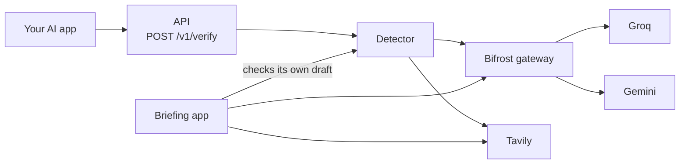

# Carbon Date

**Checks whether an AI answer is still true.**

Geek Room Global AI Hackathon 2026 · Team Jenx


▶ **[Watch the demo on YouTube (2 min)](https://www.youtube.com/watch?v=ry31t3oniZ4)** · [video file](demo/carbon-date-demo.mp4)

## The problem

**AI answers carry no date.** A model's knowledge stops at its training cutoff, but it
answers with the same confidence either way.

- **What goes stale:** who holds a role, prices and plans, software versions, laws and regulations.
- **Who is exposed:** any AI app that answers without live search, such as custom assistants, support bots and tools that answer from stored documents.
- **Why it is hard to catch:** nothing fails. No error is logged. The first signal is a user who acted on a wrong answer.
- **Why a web search alone is not enough:** the web is stale too. Company bios, wikis and profile pages often carry no date and lag behind events.

We hit this ourselves. Four days after Nvidia's CEO resigned, our own hand-written test
still said he was CEO, and so did the undated pages in the search results. Only dated
news showed the change.

**Carbon Date addresses two hackathon problem statements:**

| | Problem statement | Our answer |
|---|---|---|
| **06** | Build a Stale-Answer Detector for AI Applications | A verification layer: an API any AI app can call, plus a page to try it |
| **05** | Build a Pre-Meeting Briefing Agent | An AI app built on that layer, which checks its own draft |

## Example

```text
ASSISTANT:
The current CEO of Nvidia is Jensen Huang. The latest Python is 3.12.4...

FRESHNESS CHECK: 3 of 4 claims are out of date.
  - Said: The current CEO of Nvidia is Jensen Huang
    Now:  Colette Kress (interim CEO)
  - Said: The latest Python is 3.12.4
    Now:  Python 3.15.2
```

Real run, 16 November 2026. Each correction comes with a source.

## Three ways to use it

| | What | For |
|---|---|---|
| **API** | `POST /v1/verify` | Your own AI app |
| **Detector page** | Paste an answer, see the result | Checking by hand |
| **Briefing page** | One-page brief before a meeting, self-checked | Meeting prep |

## Quick start

Needs Python 3.12+, Node.js 20+, and free keys from [Tavily](https://tavily.com),
[Groq](https://console.groq.com) and [Google AI Studio](https://aistudio.google.com).

**1. Install**

```bash
git clone https://github.com/mgoblimar/bifrost_tavily_global_ai_hackathon.git
cd bifrost_tavily_global_ai_hackathon
python -m venv .venv
.venv/Scripts/python -m pip install -r requirements.txt
```

**2. Keys.** Copy `.env.example` to `.env` and fill in:

| Variable | Value |
|---|---|
| `GROQ_API_KEY`, `GEMINI_API_KEY`, `TAVILY_API_KEY` | Your keys |
| `BIFROST_VIRTUAL_KEY` | Any secret starting with `sk-bf-` |
| `BIFROST_SETUP_TOKEN` | Any secret |

**3. Run**, one terminal each:

```bash
powershell -ExecutionPolicy Bypass -File scripts/start_bifrost.ps1
```

```bash
.venv/Scripts/python -m uvicorn api:app --port 8600
```

```bash
.venv/Scripts/python -m streamlit run app.py
```

**4. Try**

| | |
|---|---|
| Chat app | `.venv/Scripts/python -m examples.guarded_chat "Who is the CEO of Nvidia?"` |
| API docs | http://localhost:8600/docs |
| Pages | http://localhost:8501 |

<details>
<summary>macOS / Linux</summary>

Untested. Use `.venv/bin/python`, and start the gateway with:

```bash
set -a && . ./.env && set +a && npx -y @maximhq/bifrost -app-dir ./bifrost -port 8090
```

</details>

<details>
<summary>Troubleshooting</summary>

| Error | Fix |
|---|---|
| "failed to create listener" | Port 8090 is taken. Change `-port` and `BIFROST_URL`. |
| "is empty in .env" | Fill the key in. Each variable must appear once. |
| "virtual key is required" | Restart the gateway. |
| "Model ... is not allowed" | Model retired. Update the model names in `.env`. |
| "rate-limited" | Free tier hit. Wait a minute. |
| "Cannot reach the Bifrost gateway" | Start the gateway. |
| Dashboard asks for a setup token | Enter `BIFROST_SETUP_TOKEN`. |

List available models:

```bash
curl -H "x-bf-vk: sk-bf-..." http://localhost:8090/v1/models
```

</details>

## Use the API

```python
report = requests.post(
    "http://localhost:8600/v1/verify",
    json={"answer": answer_from_your_model},
    timeout=180,
).json()

for claim in report["claims"]:
    if claim["is_stale"]:
        print(claim["claim"], "->", claim["current_value"])
```

Full example: [examples/guarded_chat.py](examples/guarded_chat.py)

<details>
<summary>Request and response</summary>

| Request field | |
|---|---|
| `answer` | Text to check (required, max 8,000 characters) |
| `trusted_domains` | Official sites to search first (optional) |
| `context` | What the answer is about (optional) |

```json
{
  "overall_freshness": 15,
  "claims_checked": 1,
  "stale_claims": 1,
  "claims": [
    {
      "claim": "The latest stable Python release is 3.12",
      "verdict": "outdated",
      "is_stale": true,
      "freshness_score": 15,
      "current_value": "Python 3.15",
      "evidence_basis": "Dated news",
      "sources": [{"title": "...", "url": "...", "published": "2026-10-07",
                   "official": false, "used_for_verdict": true}]
    }
  ]
}
```

Set `CARBON_DATE_API_KEY` to require an `X-API-Key` header.

</details>

## How it works



**Detector**

1. A fast model extracts the time-sensitive claims.
2. Tavily searches trusted sites, the web, and dated news.
3. A stronger model gives a verdict from those sources only.
4. Code turns the verdict into a 0-100 score.

**Briefing**

1. Tavily finds news from the 30 days before the meeting.
2. A model drafts one page. Items without a source are dropped.
3. The detector checks every item and your talking points.

<details>
<summary>Scoring</summary>

Computed in [stale_detector/scoring.py](stale_detector/scoring.py), not by the model.

- Base value by verdict: current 1.0, unverifiable 0.5, outdated 0.15, contradicted 0.
- Low confidence pulls the score toward 50.
- A "current" verdict loses points when sources are few or old.

</details>

## Powered by Tavily and Bifrost

Both are required for the app to work. Neither is optional.

### 🔎 Tavily: the only source of facts

Models may use nothing but Tavily's results. Code: [core/search.py](core/search.py)

| Tavily feature | Used for |
|---|---|
| General search | Finding the current state of each claim |
| News search by days | Dated evidence from the last year |
| News search by date range | The 30 days before a meeting |
| `include_domains` | Searching trusted official sites first |

### 🌉 Bifrost: the only path to a model

The app never holds a provider key. Code: [core/llm.py](core/llm.py) · [bifrost/config.json](bifrost/config.json)

| Bifrost feature | Used for |
|---|---|
| One endpoint, many providers | Groq and Gemini behind a single API |
| Routing by task | A fast model extracts claims; a stronger one verifies |
| Automatic fallback | Every call names a backup on the other provider |
| Virtual key and budget | The app's access, capped at 5 US dollars a month |
| Routing info in responses | Showing which provider answered each call |

The fallback fired for real during development, when a Gemini model returned 503 errors
and calls moved to Groq.

### 🧰 Other tools

| Tool | Role |
|---|---|
| **Python 3.12** | Language |
| **FastAPI** | The verification API |
| **Streamlit** | The detector and briefing pages |
| **Groq** | Fast model for claim extraction |
| **Google Gemini** | Stronger model for verdicts and drafting |
| **pytest** | 70 unit tests |

## Evaluation

24 hand-labelled claims · [data](eval/claims.json) · [results](eval/results.md)

| | |
|---|---|
| Correct verdicts | 22 of 22 |
| Stale claims caught | 13 of 13 |
| False alarms | 0 |
| No verdict (rate limits) | 2 |

Small set, one labeller: a sanity check, not a benchmark.

70 unit tests: `.venv/Scripts/python -m pytest -q`

## Limitations

- A check takes 20 to 75 seconds.
- Verdicts depend on what search returns.
- Free-tier rate limits can leave an item unchecked.
- Max 6 claims per answer, 5 items per briefing.
- The API has no rate limiting. Keep it on localhost.

<details>
<summary>Project layout</summary>

```
api.py              Verification API
examples/           Example chat app using the API
app.py, pages/      Web pages
core/               Bifrost and Tavily clients, settings
stale_detector/     Claims, verification, scoring
briefing/           Research, draft, cross-check
eval/               Labelled claims and results
bifrost/            Gateway config
scripts/            Gateway start script
demo/               Demo video and recording scripts
tests/              Unit tests
```

</details>
